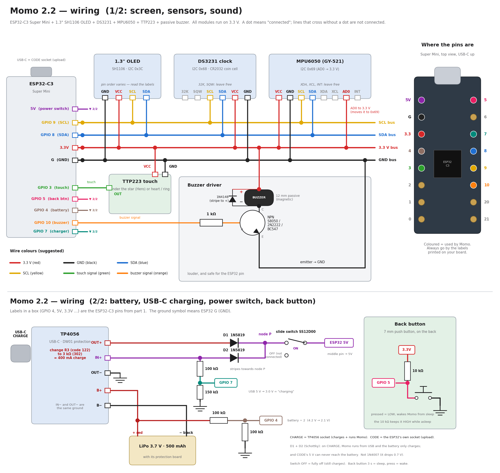

# Momo 2.2 — hardware list, costs in Hyderabad and build guide

Everything you need to buy, what it costs, where to get it in Hyderabad, and how to connect it, step by step: first on a breadboard to test, then soldered for the 3D-printed body.

- **New in 2.2:** a 500 mAh battery with **USB-C charging**, a **power slide switch**, a **back button** (works like the head touch, wakes Momo from sleep) and the **Hero Momo** body with room for all of it.
- **Time:** about 4–5 hours for a first build (test 1 h, soldering 2–2.5 h, assembly 45 min)
- **Skill:** basic soldering (wire to pin, heat-shrink) + one small SMD resistor swap on the charger board (section 3, check 6)
- **Firmware:** `2_Robot_ArduinoIDE/momo/` (upload steps: `2_Robot_ArduinoIDE/HOW_TO_UPLOAD.txt`)
- **Body:** `5_Enclosures/` → **C_Hero_Momo** (the Cube and Pod still fit Momo without a battery)

---

## 1. Shopping list with prices

Prices were checked online on 11 October 2026 (₹, including GST, one piece). Shop prices change and items go in and out of stock, so check before you go. "≈" means a typical price for small loose parts, not a quote from a shop.

### Electronics (for one Momo)

| # | Part | Qty | Price (₹) | Search for / check before you buy |
|---|---|---|---|---|
| 1 | ESP32-C3 Super Mini | 1 | 242 (Probots) | "ESP32-C3 Super Mini". USB-C, about 22.5 × 18 mm, 16 pins |
| 2 | 1.3" OLED 128×64, SH1106, I2C | 1 | 329 (Probots) | **SH1106**, **I2C with 4 pins** (not the 7-pin SPI one). White or blue, one colour (not yellow + blue) |
| 3 | TTP223 touch module | 1 | 68 (Probots) | 3 pins (VCC, I/O, GND) |
| 4 | MPU6050 module (GY-521) | 1 | 199 (Probots) | 8 pins incl. AD0 |
| 5 | DS3231 clock module (ZS-042) | 1 | 149–318 (Zbotic, was out of stock) | "DS3231 ZS-042" — common at SP Road shops |
| 6 | CR2032 coin cell | 1 | ≈ 20–30 | For the clock |
| 7 | Passive buzzer, 12 mm | 1 | ≈ 10–30 | **Passive**, not active (section 3, check 2) |
| 8 | NPN transistor S8050 / 2N2222A / BC547 | 1 | ≈ 2–5 | TO-92 |
| 9 | Resistor 1 kΩ | 1 | ≈ 1 | Buzzer driver |
| 10 | Diode 1N4148 | 1 | ≈ 1–2 | Buzzer driver |

### New in 2.2: battery, charging, switch and back button

| # | Part | Qty | Price (₹) | Search for / check before you buy |
|---|---|---|---|---|
| 11 | **TP4056 charger board, USB-C, with protection** | 1 | 49 (Probots) | "TP4056 Type C with protection" — **6 pads: IN+ IN− B+ B− OUT+ OUT−** and a DW01 chip (protection). Not the 4-pad version without protection |
| 12 | **LiPo battery 3.7 V, 500 mAh, with protection board** | 1 | 182–197 (Zbotic, 502030 / 502035), 299 (Probots) — both out of stock when checked | "502035 500mAh" or "502030 500mAh". Must fit **7 × 30 × 42 mm** (thickness × width × length, incl. the little board). JST or bare wires both fine. **Not** an 18650, not a pouch without its protection board |
| 13 | **Schottky diode 1N5819** (or SS14) | 2 | ≈ 3–5 each | Must be **Schottky** (0.3 V drop). A 1N4007 drops 0.7 V — too much |
| 14 | **Mini slide switch SS12D00**, **G4 or G5** lever (4–5 mm) | 1 | ≈ 5–10 | 3 pins, 2 positions. The **lever length** matters: G2/G3 levers are too short to reach through the back |
| 15 | **7 mm round push button, momentary** (PBS-110 type) | 1 | ≈ 10–20 | "7mm mini push button momentary", **normally open**, red cap looks heroic |
| 16 | Resistor 10 kΩ | 1 | ≈ 1 | Pull-up for the back button |
| 17 | Resistor 100 kΩ | 3 | ≈ 1 each | Battery and USB sense dividers |
| 18 | Resistor 150 kΩ | 1 | ≈ 1 | USB sense divider (a 120 kΩ or 220 kΩ also works) |
| 19 | SMD resistor 3 kΩ (code **302**, 0603 or 0805) | 1 | ≈ 1–5 | Sets about 400 mA on a standard TP4056; verify against the cell rating and board (section 3, check 6) |

Board for comparison: the Seeed **XIAO ESP32-C3** (₹649, techiesms, in stock) has a charger built in — see *why not* in `README.md`.

### Wires, consumables and body hardware

| Part | Qty | Price (₹) | Note |
|---|---|---|---|
| Silicone wire, 28–30 AWG, 6 colours | ~1 m each | ≈ 100–150 | Thin and soft |
| Heat-shrink tube 1.5 mm and 3 mm | 1 short pack | ≈ 30–50 | Every joint |
| Solder 0.6–0.8 mm, flux core | | ≈ 50–100 | |
| Double-sided foam tape | small piece | ≈ 30 | TTP223, battery, charger board |
| Super glue (CA) | | ≈ 20–40 | Mask visor, buzzer, slide switch |
| M2 × 6 mm self-tapping screws | 2 | ≈ 10 | OLED retainer |
| M2 × 8 mm self-tapping screws | 2 | ≈ 10 | Back plate (from underneath) |
| Rubber bumpers, 8 mm | 4 | ≈ 20–40 | Under the body |
| PLA filament | ~75 g | ≈ 90–110 (spool ≈ 1,100–1,400 per kg) | Blue/white body + red cape + black mask |

### What one Momo 2.2 costs

| Group | ₹ (about) |
|---|---|
| Momo electronics (items 1–10) | 1,050–1,250 |
| New power + button parts (items 11–19) | 270–400 |
| Wires, consumables, screws, feet | 300–450 (most of it is left over for the next build) |
| Print (Hero Momo, ~75 g PLA) | 90–110 |
| **Total for the first Momo** | **≈ 1,700–2,200** |

Delivery from the online shops below is usually ₹50–100 extra unless your order is large.

### Where to buy in Hyderabad

| Where | What to expect |
|---|---|
| **SP Road, Secunderabad** | A street of electronics shops: ESP32 boards, sensors, OLEDs, LiPo cells, switches, resistors, diodes. Good for the small parts and for batteries you can see before buying. Quality varies — test boards before you pay. |
| **Abids electronics market** (around Sultan Bazaar / Abids Main Road) | Loose components (resistors, diodes, switches, buzzers), wires, heat-shrink, coin cells, often cheaper; bargaining is normal. |
| **KSP Electronics, Uppal** | Hyderabad store with online ordering. |
| **Online, delivered in 1–3 days:** Probots (Bangalore), Robu (Pune), Zbotic | Used for the prices above. Probots lists 1–3-day express shipping across India. |

Tip: TTP223 modules, buzzers, transistors, slide switches and push buttons are cheap and easy to damage — buy two of each.

### Tools

Temperature-controlled soldering iron (330–350 °C, fine tip for the SMD resistor), side cutter, wire stripper for 28–30 AWG, **multimeter**, tweezers, "helping hands", small screwdriver, 7 mm drill bit only if your back-button hole prints tight.

---

## 2. Wiring



### Signals (same as 2.1)

| From (module pin) | To | Wire colour (suggested) |
|---|---|---|
| OLED **VCC**, DS3231 **VCC**, MPU6050 **VCC**, TTP223 **VCC**, buzzer **+** | ESP32-C3 **3.3V** | red |
| OLED **GND**, DS3231 **GND**, MPU6050 **GND**, TTP223 **GND**, transistor **E** | ESP32-C3 **G** | black |
| OLED **SDA**, DS3231 **SDA**, MPU6050 **SDA** | ESP32-C3 **GPIO 8** | blue |
| OLED **SCL**, DS3231 **SCL**, MPU6050 **SCL** | ESP32-C3 **GPIO 9** | yellow |
| MPU6050 **AD0** | **3.3V** (address 0x69, away from the clock at 0x68) | red |
| TTP223 **I/O** | ESP32-C3 **GPIO 3** | green |
| ESP32-C3 **GPIO 10** → 1 kΩ → transistor **B**; **C** → buzzer **−**; 1N4148 across the buzzer, stripe to **+** | buzzer driver | orange |

### New in 2.2: back button, battery, charging

| From | To | Why |
|---|---|---|
| Back button, one leg | ESP32-C3 **GPIO 5** | The button works like the head touch, and it wakes Momo from sleep |
| Back button, other leg | **G** | Pressed = LOW |
| 10 kΩ | between **GPIO 5** and **3.3V** | Keeps the pin HIGH while Momo sleeps (the chip's own pull-up switches off in deep sleep) |
| TP4056 **B+** / **B−** | battery **red +** / **black −** | Charges the battery; the board's DW01 chip protects it |
| TP4056 **OUT+** → diode **D1** (stripe away from OUT+) | node **P** | Battery → Momo (only when USB is not plugged in) |
| TP4056 **IN+** → diode **D2** (stripe away from IN+) | node **P** | USB-C → Momo while charging, so the charger sees only the battery and stops properly when full |
| Node **P** (both diode stripes) | slide switch, **outer pin on the ON side** | |
| Slide switch **middle pin** | ESP32-C3 **5V** | ON/OFF for everything |
| TP4056 **OUT−** | ESP32-C3 **G** | Common ground (IN− and OUT− are the same ground on these boards) |
| TP4056 **B+** → 100 kΩ → **GPIO 4** → 100 kΩ → **G** | battery voltage | Momo reads half the battery voltage (max 2.1 V) |
| TP4056 **IN+** → 100 kΩ → **GPIO 7** → 150 kΩ → **G** | "charger plugged in" | 5 V × 150 / 250 = 3.0 V = HIGH; 0 V when unplugged |

Two USB-C sockets on Momo's back:

| Socket | Board | Use it for |
|---|---|---|
| **CHARGE** (bottom corner) | TP4056 | Charging. Momo runs from it while charging, even with the switch ON |
| **CODE** (middle) | ESP32-C3 | Uploading firmware and the Serial Monitor. It also powers Momo (switch on or off), but does **not** charge the battery |

The two diodes are what make this safe: the PC's 5 V on the CODE socket can never flow back into the battery or the charger, and the battery can never push current into the PC.

I2C addresses: OLED 0x3C, DS3231 0x68 (memory chip 0x57), MPU6050 0x69. Pins used: 3 touch · 4 battery · 5 button · 7 USB sense · 8 SDA · 9 SCL · 10 buzzer. Free: 0, 1, 2, 6, 20, 21.

**Why the transistor for the buzzer?** A 12 mm magnetic buzzer needs more current than an ESP32 pin should give. Through the transistor it is louder and safe; the diode protects the transistor from the coil's voltage spike.

---

## 3. Before you solder: 7 checks

1. **OLED pin order.** Some boards are `GND VCC SCL SDA`, others `VCC GND SCL SDA`. Read the labels. Swapping VCC and GND can destroy the screen.
2. **Passive or active buzzer?** Put 3 V across it for a second. **Passive (right):** only a click. **Active (wrong):** a continuous beep. A passive magnetic buzzer reads about 16–42 Ω.
3. **Transistor legs.** Flat side towards you, legs down: **S8050 and 2N2222A = E B C**, **BC547 = C B E**.
4. **TTP223 jumpers.** Leave pads A and B open. Do not touch the pad while powering on (it calibrates in the first second).
5. **DS3231 coin cell.** Powered from 3.3 V the ZS-042's charging circuit does nothing, so a normal CR2032 is fine.
6. **TP4056 charge current — important for a 500 mAh battery.** Many boards are set to **1 A** (often resistor **R3**, code **122** = 1.2 kΩ, next to the chip's PROG pin 2), but clone layouts and resistor designators vary. Identify the TP4056 PROG resistor from the board markings/datasheet before changing anything; do not rely on position alone. A **3 kΩ** PROG resistor gives about **400 mA** on a standard TP4056. Confirm that the battery maker allows at least 400 mA (0.8 C for a 500 mAh cell); if its specified maximum is lower, choose a lower charge current or a compatible charger. With a fine tip: add solder to both ends, lift the old resistor with tweezers, solder the new one. If you cannot identify the resistor or do SMD soldering, have a qualified person verify and modify it.
7. **Battery polarity and voltage.** Before connecting, measure the battery with the multimeter: red = +, about 3.6–4.2 V. Some cells have the colours swapped on the JST plug — trust the meter, not the colour. Never short the wires; cut and solder **one wire at a time**.

---

## 4. Step 1 — Test everything on a breadboard (about 1 h)

A fault is easy to find on a breadboard and hard to find inside the body.

1. **Headers** on the ESP32-C3 (pins down) and the MPU6050.
2. **ESP32-C3** across the middle gap, USB-C at the edge. Jumper **3.3V** → red (+) rail, **G** → blue (−) rail.
3. **I2C:** OLED, DS3231, MPU6050 → VCC to +, GND to −, SDA → GPIO 8, SCL → GPIO 9. **MPU6050 AD0** → +.
4. **TTP223:** VCC → +, GND → −, I/O → GPIO 3.
5. **Buzzer driver:** 1 kΩ from GPIO 10 to **B**; **E** → −; **C** → buzzer −; buzzer + → +; 1N4148 across the buzzer, stripe on +.
6. **Back button:** push button between **GPIO 5** and **G**; 10 kΩ from **GPIO 5** to **+**.
7. **Check before power:** continuity mode, **no beep between + and −**.
8. **Upload** the firmware (USB in the ESP32's own socket). Serial Monitor at 115200:
   ```
   Hello! I am Momo. (version 2.2)
   Screen: OK | Clock module: OK | Motion sensor: OK
   Momo 2.2: hero look and sounds are on (change them in the app)
   ```
9. **Test each part:** face (eyes with a little hero mask), touch (tap = pet, hold 1 s and let go = menu, double-tap = back, keep your hand on it = rub), back button (the same gestures; hold 3 s = sleep, press = wake), sound, motion (Games → Catch), clock (unplug, plug in, time still right).
10. **Now the power part,** still on the bench, battery **not** yet connected:
    - Solder D1 and D2 (stripes to node P), the slide switch, and the two dividers as in section 2.
    - Connect the TP4056 **OUT−** to the − rail, node P through the switch to the ESP32 **5V** pin. Unplug the ESP32's own USB.
    - Plug a USB-C cable into the **TP4056**: with the switch ON Momo starts (from USB through D2). Serial is not available on this socket — look at the screen: the battery icon is hidden (no battery yet).
11. **Battery:** unplug everything, switch OFF. Solder battery **+** to **B+** and **−** to **B−** (one wire at a time). Switch ON → Momo starts from the battery; the battery icon shows the level. Plug USB-C into **CHARGE** → the charging screen with a lightning bolt, and the TP4056's red LED. When full: "Full!" on Momo, blue/green LED on the board.
12. **Sleep:** hold the back button 3 s → "Good night!", screen off. Press it → Momo starts again. Slide the switch OFF → Momo is fully off (it still charges when plugged into CHARGE).

Only when all of this works, go on.

---

## 5. Step 2 — Solder the final wiring (about 2–2.5 h)

The Hero body has three groups of parts:

| Face side (fixed in the shell) | Tray (slides out of the back) | Under the deck + back plate |
|---|---|---|
| OLED, buzzer + its driver, TTP223 | ESP32-C3, DS3231, MPU6050 | Battery, TP4056, diodes, dividers (under the deck) · slide switch and back button (on the back plate) |

Leave wires long enough to open Momo: **8–10 cm** between face and tray, **12 cm** from the back plate (switch, button) to the inside.

### 5a–5e. Momo's signals

Same as 2.1 — wire the tray (ESP32-C3 → MPU6050 → DS3231), the face harness (DS3231 second header → OLED), the TTP223 and the free-wired buzzer driver exactly as before:

1. ESP32-C3 → MPU6050: red **3.3**→VCC, black **G**→GND, blue **8**→SDA, yellow **9**→SCL (5 cm). AD0 → VCC on the MPU6050 (1 cm wire).
2. MPU6050 → DS3231 6-pin side: VCC, GND, SDA, SCL (4 cm). Coin cell in.
3. DS3231 4-pin side → OLED: VCC, GND, SDA, SCL (10 cm, twisted).
4. TTP223: VCC and GND from the OLED's pins (4 cm), **I/O → GPIO 3** (10 cm, green).
5. Buzzer driver at the face: 1 kΩ on **B**, orange 10 cm to **GPIO 10**, **C** → buzzer −, **E** → OLED GND, buzzer + → OLED VCC, 1N4148 across the buzzer (stripe on +). Heat-shrink everything.

### 5f. Power block (lies under the deck)

6. **Charge current:** R3 changed to 3 kΩ (section 3, check 6).
7. **Diodes:** solder D1 to **OUT+** and D2 to **IN+**, stripes pointing away from the board. Twist the two stripe ends together, solder, add a 12 cm red wire = **node P**. Heat-shrink the whole diode pair.
8. **Battery divider:** 100 kΩ from **B+** to a junction, 100 kΩ from the junction to **OUT−**. A 15 cm white wire from the junction → **GPIO 4**. Heat-shrink.
9. **USB sense divider:** 100 kΩ from **IN+** to a junction, 150 kΩ from the junction to **OUT−**. A 15 cm grey wire from the junction → **GPIO 7**. Heat-shrink.
10. **Ground:** a 15 cm black wire from **OUT−** → ESP32-C3 **G**.
11. **Battery** last: + to **B+**, − to **B−**, one wire at a time. Wrap the TP4056 board's underside with one layer of tape.

### 5g. Back plate: slide switch and back button

12. **Slide switch:** with the multimeter find which outer pin connects to the middle pin when the lever is on the **ON** side of the slot (the side closer to the middle of Momo's back). Node P (red) → that outer pin. A 12 cm red wire from the middle pin → ESP32-C3 **5V**. Cut the unused outer pin short.
13. **Back button:** screw it into the 7 mm hole (nut inside). One leg → 12 cm wire → **GPIO 5**, other leg → 12 cm black wire → **G**. The 10 kΩ pull-up goes at the ESP32 between **GPIO 5** and **3.3**.

### 5h. Check before power

14. Switch OFF, nothing plugged in, multimeter in continuity mode:
    - **3.3 to G on the ESP32-C3: no beep. 5V to G: no beep.**
    - Node P to ESP32 5V: beep only with the switch ON.
    - GPIO 8 to each SDA, GPIO 9 to each SCL: beep.
15. Voltage mode: battery at B+ / B− 3.6–4.2 V; GPIO 4 to G about half of that.
16. Switch ON → Momo starts from the battery. Plug CHARGE → charging screen.

---

## 6. Step 3 — Put it in the Hero body (about 45 min)

Full steps with pictures: `5_Enclosures/README.md` → *Design C — Hero Momo*. In short:

1. Glue the black **mask visor** into the face (its ring centres it).
2. OLED into its frame (glass to the window, ribbon down) → retainer → 2 × M2×6.
3. Buzzer into the cup behind the smile. TTP223 into the pocket under the **star** on the head, foam tape.
4. Looking into the open back: the **battery** goes flat on the floor in the **right** bay (under the deck), wires towards you. The **TP4056** goes into the slot on the **left**, USB-C facing you, flat on its two ledges, with a dab of hot glue or foam tape. Its USB-C must line up with the **CHARGE** hole.
5. Lead the power wires up through the open space behind the deck.
6. Tray: DS3231 upright in the groove, MPU6050 upright between its posts, ESP32-C3 into the rails (USB-C back). Slide the tray in **on top of the deck** until it stops.
7. **Back plate:** slide switch into its pocket from the inside (lever through the slot), a drop of glue on its sides. Back button through the 7 mm hole, nut on the inside. Hook the plate in at the top, 2 × **M2×8** from underneath.
8. **Cape:** push its two pegs into the holes on the head. The star window frames the back button.
9. Rubber feet.

---

## 7. Power and battery life

| Part | Current (about) |
|---|---|
| ESP32-C3 with Wi-Fi + Bluetooth | 80–120 mA average, peaks around 300 mA when Wi-Fi transmits |
| OLED | 10–30 mA |
| Buzzer (only while it sounds) | 30–60 mA |
| DS3231, MPU6050, TTP223 | under 5 mA together |

| Situation | Time |
|---|---|
| On battery, Wi-Fi + Bluetooth on | **Estimated 4–5 hours** from 500 mAh; measure on the finished build |
| Charging 0 → full (R3 = 3 kΩ, 400 mA) | Estimated 1.5–2 hours; actual time depends on the cell, charger and load |
| Sleep (back button 3 s) | about 4–5 days — the boards' little power LEDs keep drawing 3–5 mA. Remove the power LEDs on the **DS3231**, the **GY-521** and the **ESP32-C3 Super Mini** (a hot iron tip on the LED) for several weeks of sleep |
| Switch OFF | Nothing is used except about 0.02 mA by the battery divider (≈ 3 years to empty) |

Momo warns at 15 % ("Battery low – please charge me with the USB-C cable") and goes to sleep by itself below about 3.35 V, before the battery's protection cuts the power.

**Power-path check:** the battery reaches the ESP32-C3 board's **5V** input through a Schottky diode; this is not a regulated 5 V supply. Board regulator designs differ, and the available input voltage falls as the cell discharges. Before closing the enclosure, check the exact board's input requirements and measure its 3.3 V rail while Momo joins Wi-Fi, including near the low-battery threshold. If it browns out or the rail leaves the board/chip's allowed range, do not use this power path; use a suitable regulated supply or a board designed for a single-cell LiPo. The stated 4–5 hour runtime is an estimate and has not been validated on a real battery in the included test report.

**LiPo safety:** charge on a hard, non-flammable surface while supervised; never leave charging unattended or charge on/near combustible material. Never puncture, bend, squeeze or short the cell; insulate exposed leads and stop using a hot, damaged or swollen battery. Use a protected battery and a charger/current setting approved for that cell. The protection circuit is not a substitute for correct wiring, charge-current selection or supervision.

---

## 8. If something does not work

| What you see | Most likely cause → fix |
|---|---|
| PC does not see the board | Charge-only USB cable → use a data cable, in the **CODE** socket. Or hold **BOOT** while plugging in |
| `Screen: NOT FOUND` | SDA/SCL swapped, OLED VCC/GND swapped, or address 0x3D → `OLED_ADDR = 0x3D` in `momo.ino` |
| Picture shifted, noisy line at one edge | SSD1306 screen → `#define SCREEN_IS_SSD1306 1` |
| `Clock module` / `Motion sensor: NOT FOUND` | AD0 not at 3.3 V, or a loose SDA/SCL wire |
| Touch fires by itself or never | Touched while powering on → restart without touching. Keep the touch wire away from the buzzer wire |
| No sound / very quiet | Transistor legs (E-B-C), diode stripe, active buzzer, or volume low in the app |
| Back button does nothing | Button between GPIO 5 and **G** (not 3.3 V); 10 kΩ pull-up to 3.3 V present |
| Momo will not wake from sleep | Same as above — waking needs GPIO 5 to go LOW. Or slide the switch OFF and ON |
| Serial says "Back button is down at start" | The button was held (or is stuck / shorted to G) while Momo started. Momo ignores it until it is let go, so it can never sleep again and again. If it stays, check the button wiring |
| No battery icon | Battery divider missing or on the wrong pin (GPIO 4); battery below 2.5 V |
| Battery % jumps around | Normal for a few seconds after plugging/unplugging; it settles. Check both 100 kΩ |
| "Charging" never shows | USB sense divider on GPIO 7 missing, or USB is in the CODE socket (that one does not charge) |
| Never reaches "Full!" / board gets hot | R3 still 1.2 kΩ (1 A) → change to 3 kΩ. A weak USB charger can also stop early |
| Momo restarts on Wi-Fi or beeps, on battery | Battery nearly empty, or 1N4007 used instead of Schottky diodes |
| Momo is off with the switch ON | Battery empty → plug into CHARGE. Or the switch is wired to the wrong outer pin |
| Restarts when beeping or on Wi-Fi (USB) | Weak USB cable or charger |

Sources for the prices: [Probots ESP32-C3 Super Mini](https://probots.co.in/esp32-c3-supermini-wifi-bluetooth-development-board-32-bit-risc-v-uart-i2c-spi.html) · [Probots TP4056 Type-C with protection](https://probots.co.in/tp4056-1a-li-ion-lithium-battery-charging-module-with-current-protection-type-c.html) · [Probots 1.3" OLED SH1106](https://probots.co.in/1-3-inch-128x64-oled-blue-display-sh1106-i2c.html) · [Probots TTP223](https://probots.co.in/capacitive-touch-switch-button-module-ttp223-1-key.html) · [Probots MPU6050](https://probots.co.in/mpu6050-6dof-imu-sensor-module-gyroscope-accelerometer-gy521.html) · [Probots 500 mAh LiPo](https://probots.co.in/lithium-ion-rechargeable-battery-3-7v-500mah-kp-502530.html) · [Zbotic 502035 500 mAh LiPo](https://zbotic.in/product/kp-original-502035-500mah-3-7vsingle-cell-rechargeable-lipo-battery/) · [Zbotic 502030 500 mAh LiPo](https://zbotic.in/product/kp-original-502030-500mah-3-7vsingle-cell-rechargeable-lipo-battery/) · [Zbotic RTC modules](https://zbotic.in/product-category/electronic-modules-and-displays/electronic-modules/rtc-module/) · [techiesms XIAO ESP32-C3](https://techiesms.com/product/seeed-studio-xiao-esp32c3-the-smallest-esp32c3-development-board/) · [Hyderabad shops (KSP Electronics guide)](https://kspelectronics.in/where-to-buy-arduino-in-hyderabad-best-shops-and-online-stores-2026/)
