# Momo — an ESP32-C3 desk companion robot

<p align="center">
  
</p>

<p align="center"><em>Hero Momo enclosure design render (CAD visualization; not a photograph of a completed physical build).</em></p>

Momo is a small desk robot with a face on a 1.3" OLED screen. It reacts when you pet it, purrs when you rub its head, follows your day (wakes up, gets sleepy, sleeps at night), reminds you to drink water, stretch and do the things you must not forget, rings your alarms, shows your phone's notifications, calls, music and animated weather, plays games with you, and is controlled from a secure web app that it serves itself — no cloud, no account, no app install.

Version **2.2** makes Momo cordless and gives it a hero costume: a **500 mAh battery with USB-C charging**, a **back button** that does everything the head does, a **double-tap = back** gesture everywhere, a **head rub** you can feel, **animated weather** with your own refresh time, and **Mini superhero Momo** — an original hero look and sound set for the screen and a matching 3D-printed body with a mask and a cape.

| | |
|---|---|
| **Firmware version** | 2.2 |
| **Board** | ESP32-C3 Super Mini (Arduino-ESP32 core 3.1.1 or newer; tested on 3.1.1 and 3.3.12) |
| **Language** | C++ (Arduino), one sketch + 10 header files |
| **Power** | USB-C, or a 500 mAh LiPo charged over a second USB-C socket; 4–5 hours is an unvalidated runtime estimate |
| **Phone** | Android: free *Chronos* app (Bluetooth) + the *Momo app* (opens in Chrome over Wi-Fi) |
| **Simulator** | Wokwi in VS Code — prebuilt firmware included, with a battery knob, charger switch and back button |
| **Tests** | 513 automatic checks, a full run on Espressif's ESP32-C3 emulator (QEMU), browser tests of the app, fit checks of every printed part |
| **Body** | Three 3D-printable designs for the Bambu Lab A1 mini (PLA, no supports): **Hero Momo** (new, with battery), *Momo Cube*, *Momo Pod* |
| **Cost** | about ₹1,700–2,200 for the first Momo in Hyderabad (details in [`HARDWARE_GUIDE.md`](HARDWARE_GUIDE.md)) |

---

## Contents

1. [What's new in 2.2](#whats-new-in-22)
2. [What Momo does](#what-momo-does)
3. [Use cases](#use-cases)
4. [Pictures](#pictures)
5. [Hardware and cost](#hardware-and-cost)
6. [Wiring](#wiring)
7. [3D-printed body](#3d-printed-body)
8. [Quick start](#quick-start)
9. [How to talk to Momo](#how-to-talk-to-momo)
10. [How it works](#how-it-works)
11. [Why these parts and tools — and why not the others](#why-these-parts-and-tools--and-why-not-the-others)
12. [Security and privacy](#security-and-privacy)
13. [The Momo app and its API](#the-momo-app-and-its-api)
14. [How it was tested](#how-it-was-tested)
15. [Project structure](#project-structure)
16. [Customising](#customising)
17. [Troubleshooting](#troubleshooting)
18. [Roadmap](#roadmap)
19. [Credits and licences](#credits-and-licences)

---

## What's new in 2.2

| Feature | What you get |
|---|---|
| **Battery + USB-C charging** | 500 mAh LiPo through a TP4056 USB-C charger board with protection. Battery icon in the status bar, a charging screen with a power-up sound, "Full!", a *Battery low* warning at 15 %, and Momo goes to sleep by itself before the battery is empty. Momo keeps running while it charges. |
| **Two USB-C sockets** | **CHARGE** (charger board) and **CODE** (ESP32 — uploading and the Serial Monitor). Two Schottky diodes keep them from ever fighting each other. |
| **Power switch + sleep** | A slide switch turns Momo fully off (it still charges). Holding the back button 3 s puts Momo to sleep; pressing it wakes Momo up — and Momo wakes up by itself just before your next alarm or reminder. |
| **Back button** | A real button on Momo's back that works exactly like the touch sensor (tap, hold, double-tap), so if a sensor ever fails, the button still talks to you. |
| **Back is a gesture, not a button** | **Double-tap = back** on the head *or* the button, on every screen: out of a game, up one menu level, close a screen, cancel pairing. In Jump and Flappy (where taps are jumps) hold = back. The app has a Back button too. Hints on the screen show how. |
| **Head rub** | Keep your hand on Momo's head: it closes its eyes, purrs every 1.5 s and its affection grows; let go after a long rub and it shows love. Let go after about 1 s instead and you get the menu as before. The same cheap TTP223 — no extra sensor. |
| **Mini superhero Momo** | An original hero theme: a little mask around the eyes on all 46 expressions, a hero buddy with a cape who flies in, drinks water and powers up, a hero workout for the stretch break (hips, punches, squat, jump), a star at start-up, and **46 + 17 hero sounds** (a hero version of every emotion sound, power-up fanfares for water, games, charging and sleep). The classic look and the other 4 sound themes are one tap away in the app. |
| **Animated weather** | Full-screen scenes: sun rays, drifting clouds, rain with splashes, storm flashes, falling snow, fog bands, wind with a leaf — plus "updated 12m ago from the phone / web". |
| **Weather your way** | In the app: refresh every 10 / 15 / 30 minutes, 1 / 2 / 3 hours; source **Auto** (phone first, internet as backup), **Phone** only (Chronos, no Wi-Fi needed) or **Internet** only (Open-Meteo); **Update now** button; last update shown. |
| **App** | Battery on the home page, Back and Update-weather buttons, a "Talk to Momo" help card, *Momo's look* (Mini hero / Classic, sounds, head rub on/off, low-battery warning on/off). |
| **Hero Momo body** | A new 3D-printable body with a battery bay, a slot for the charger board, a domino-mask visor, a star touch spot on the head, lightning bolts on the sides and a red cape whose star window frames the back button. |
| **Keeps everything** | Uploading 2.2 over 2.1 keeps your settings, alarms, reminders, paired phones, pets, scores and Wi-Fi. On the first start Momo switches to the hero look and sounds (one tap to go back). |

The **simulator** has the new parts too: a red push button (B key) for the back button, a knob for the battery and a slide switch for the charger cable.

## What Momo does

| Area | What you get |
|---|---|
| **Face** | 46 expressions (happy, love, sleepy, angry, dizzy, curious, proud, glitch, celebrate …) that glide smoothly from one to the next, with blinking, looking around, motion and overlays. In the hero look every face wears a little mask. Menu → *46 expressions* shows them all. |
| **Sounds** | Every emotion has its own sound. 5 sound themes: **hero**, cute, robot, soft, retro. Volume, sound on/off per type, quiet hours, hourly chime, your own tune. |
| **Personality** | Remembers how much you pet and rub it (affection 0–100). Quick pets make it giggle, every 10th pet shows heart eyes, a long rub makes it purr and fall in love; it gets a little lonely when ignored. |
| **Day rhythm** | Good-morning screen at wake time, sleepy faces in the evening, sleeps at night (screen dimmed, sounds off). |
| **Your own reminders** | Type anything in the app ("Book ticket" at 4:30 PM): once, every day, or on chosen weekdays — up to 10. Momo shows your words and rings until you tap; hold = again in 5 minutes. |
| **Water and stretch** | Exact times (up to 8 each) and/or every X minutes between two times, with a daily goal. Hero animations: the hero buddy flies in with a water bottle and powers up; a hero workout for the stretch break. |
| **Alarms** | 8 alarms (days, label, snooze, 4 melodies incl. your own tune) + the Chronos app's alarms. Tap = snooze, hold = stop. Momo wakes itself from sleep for them. |
| **Games you play** | Jump, Flappy, Catch (tilt Momo), Reaction, Simon, Copy me, Rhythm, Rock paper scissors. Best scores are saved. Double-tap (or hold in Jump/Flappy) = back to the games. |
| **Momo plays alone** | When bored — and only in play hours — Momo plays Pong by itself. |
| **Music** | Song title and artist from your phone; tap = play/pause, tilt right/left = next/previous. |
| **Weather** | Animated full-screen weather from the Chronos app or the internet, refresh time and source of your choice. |
| **Battery** | Level in the status bar and in the app, charging screen, low-battery warning, automatic sleep when empty. |
| **Phone** | Notifications, incoming calls, "find my device", time sync. |
| **Extras** | Focus timer, hourly chime, space-station-overhead alert, hugs between Momos over ESP-NOW. |

## Use cases

| Who | How Momo helps |
|---|---|
| **Students** | A focus timer with breaks, a stretch break every 45 minutes, water reminders, and your exam/assignment reminders on the desk — without picking up the phone. |
| **Office and work-from-home** | Notifications and calls on the desk while the phone stays face-down; hydration and posture breaks on a schedule; quiet hours for meetings. Cordless, so it moves with you between desk and table. |
| **Families** | "Take medicine at 9 PM", "Pay electricity bill on the 5th", "Call Amma Sunday" — big words on the screen and a melody that rings until someone taps. The hero look makes routines (water, stretching, bedtime) fun for everyone at home. |
| **Mood and well-being** | A face that reacts, purrs when rubbed and celebrates with you is a small daily mood lift. Rub its head for a few seconds when you need a pause. |
| **Makers and learners** | One project that teaches I2C (three devices on one bus), GPIO input with debouncing and gestures, PWM sound, deep sleep, battery measurement with an ADC, a LiPo charging circuit with diode-OR power paths, Bluetooth LE, Wi-Fi, a web server + JSON API, security (pairing, tokens, hashing), flash storage, 3D design for printing, and testing without hardware. |
| **Portfolio / interviews** | A complete embedded product: firmware, phone app, hardware, enclosure, documentation and automated tests — something to show, not just describe. |
| **Classrooms and clubs** | Runs in the free Wokwi simulator first, so a whole class can try it before buying a single part. |
| **Gifts** | Print it in the receiver's colours, set their name in the app, add their reminders. |

## Pictures

| Hero Momo (3D-printed body) | Back: cape, back button, CHARGE / CODE / power switch |
|---|---|
| 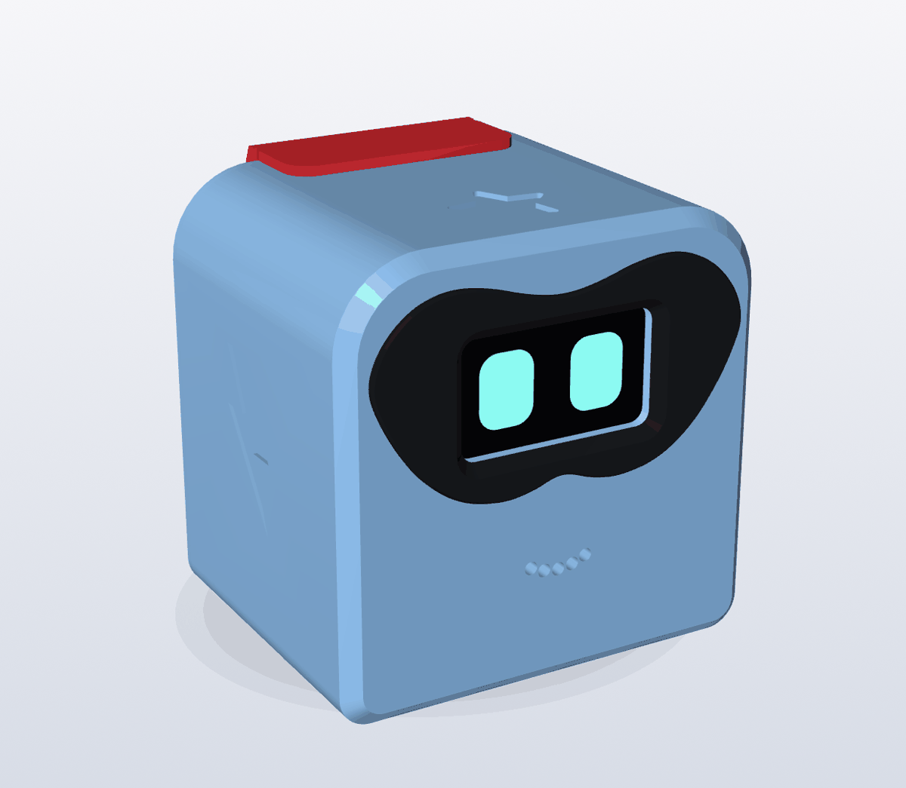 | 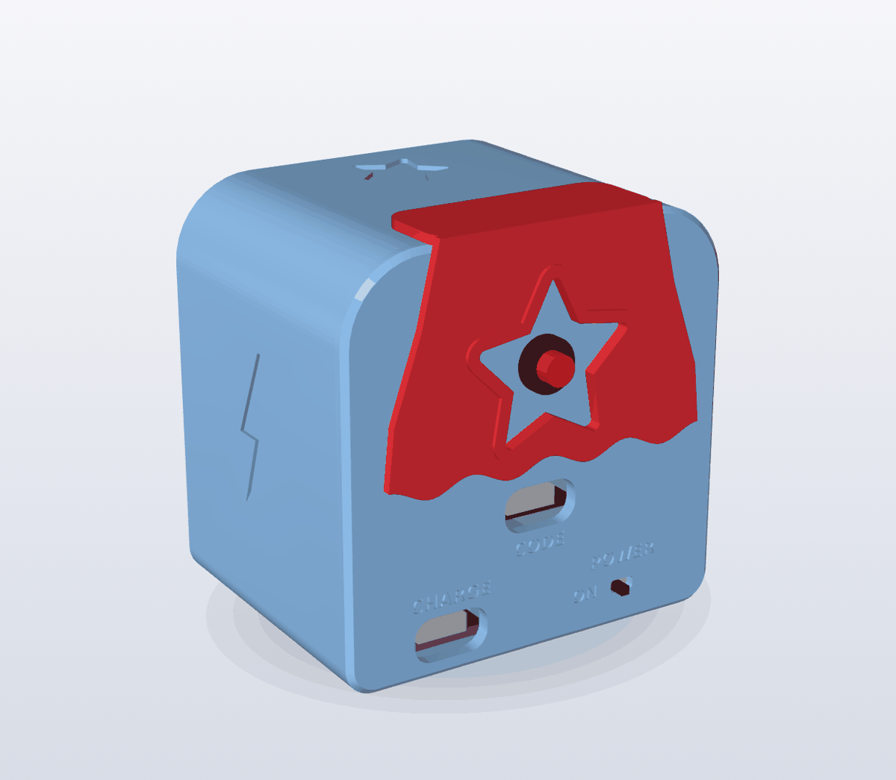 |
| **Mini superhero Momo on the screen** | **Hero water and stretch animations** |
| 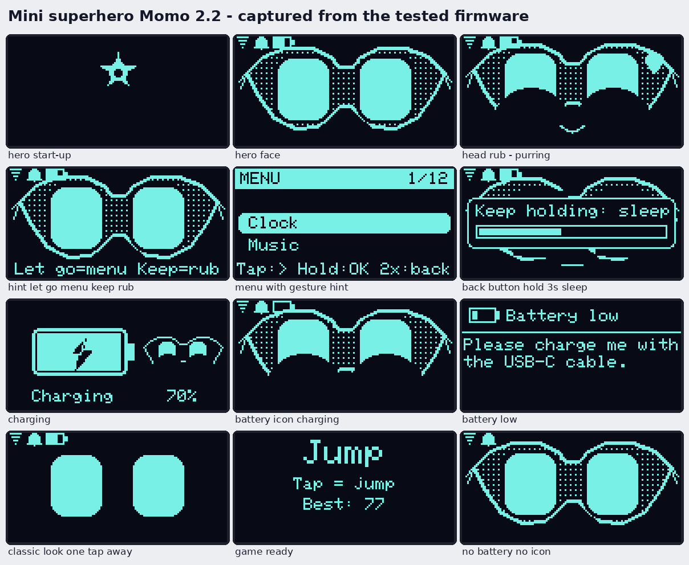 | 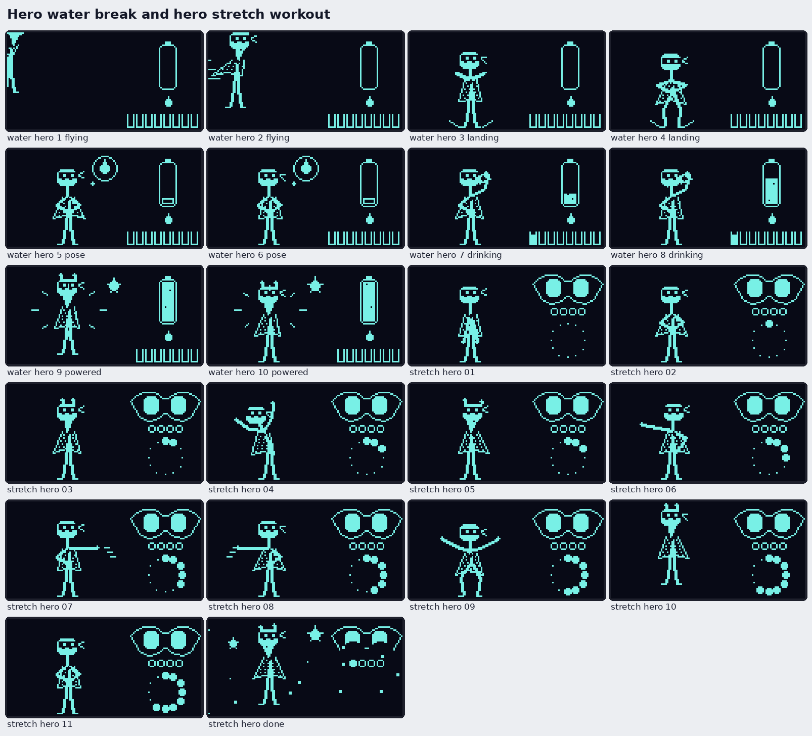 |
| **Animated weather** | **All 46 expressions with the hero mask** |
| 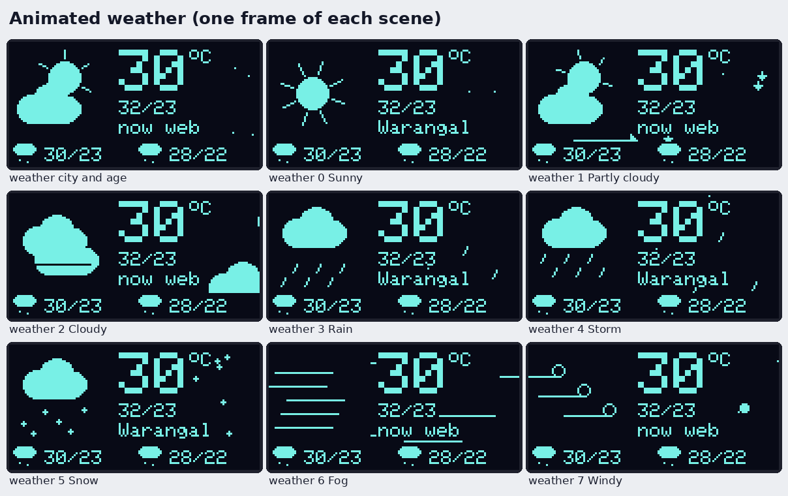 | 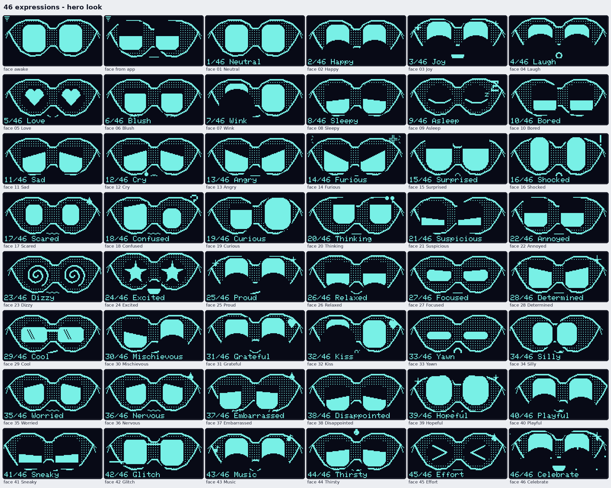 |

The Momo app (phone, Chrome):

| Home (battery) | Momo's look | Weather settings | Alarms | My reminders | Sounds |
|---|---|---|---|---|---|
| 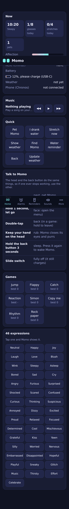 | 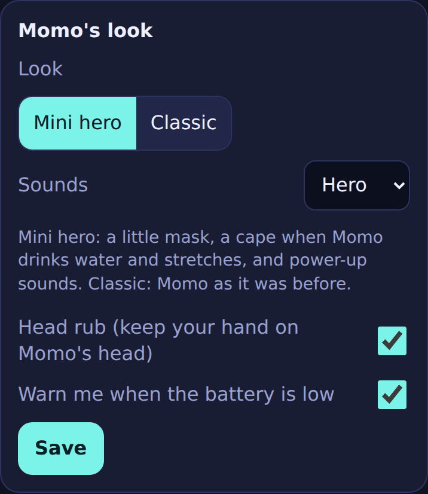 | 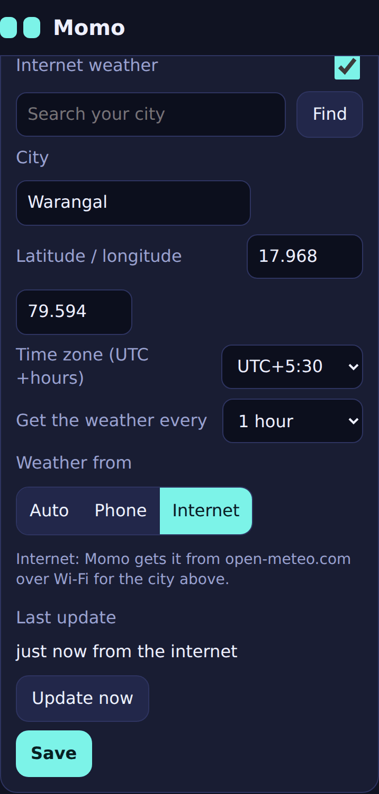 | 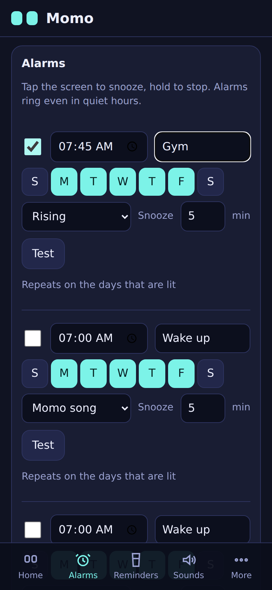 | 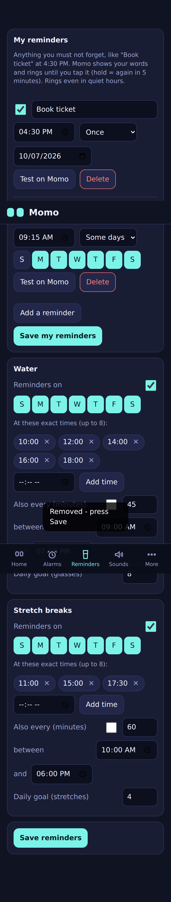 | 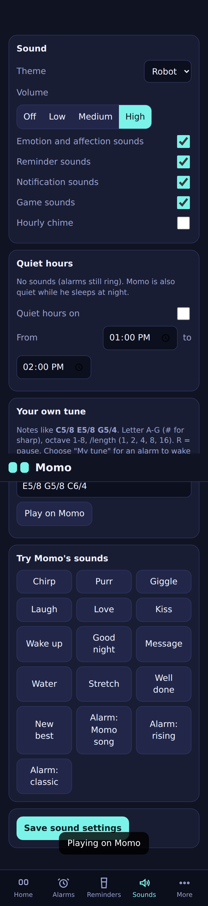 |

Earlier pictures (classic look, games, the Cube and Pod bodies) are in `4_Pictures/` too. All screen pictures are captured from the tested firmware code, not drawn by hand.

## Hardware and cost

| Part | Job | ₹ (Oct 2026) |
|---|---|---|
| ESP32-C3 Super Mini | Brain, Wi-Fi, Bluetooth LE | 242 |
| 1.3" OLED, 128×64, SH1106, I2C | Momo's face | 329 |
| TTP223 capacitive touch module | Head touch: pet, rub, menu | 68 |
| MPU6050 (GY-521) | Shake and tilt | 199 |
| DS3231 real-time clock + CR2032 | Keeps time without Wi-Fi or phone | 150–350 |
| Passive buzzer + NPN transistor, 1 kΩ, 1N4148 | Voice, melodies, alarms | ≈ 20–40 |
| **TP4056 USB-C charger board with protection** (new) | Charges the battery, protects it | 49 |
| **LiPo 3.7 V 500 mAh** (502035 / 502030, new) | Estimated 4–5 hours cordless; validate on the finished build | 180–300 |
| **2 × 1N5819 Schottky diodes** (new) | Battery and USB never fight | ≈ 10 |
| **SS12D00 slide switch, G4/G5 lever** (new) | Fully off | ≈ 5–10 |
| **7 mm push button, momentary** (new) | Back button, wakes Momo | ≈ 10–20 |
| **Resistors 10 kΩ, 3 × 100 kΩ, 150 kΩ, SMD 3 kΩ** (new) | Button pull-up, battery and USB sensing, charger-current configuration | ≈ 10 |

**About ₹1,700–2,200** for the first Momo including wires, screws and ~75 g of PLA. Where to buy in Hyderabad (SP Road in Secunderabad, the Abids market, KSP Electronics in Uppal, or online from Probots, Robu, Zbotic in 1–3 days), what to check before buying, soldering step by step and battery safety: **[`HARDWARE_GUIDE.md`](HARDWARE_GUIDE.md)**.

> **Important:** Many TP4056 boards are set to 1 A, which may exceed a 500 mAh cell's specified charge current. Verify the module's PROG resistor and the battery datasheet; 3 kΩ gives about 400 mA on a standard TP4056. Details and safety checks: [`HARDWARE_GUIDE.md`](HARDWARE_GUIDE.md).

## Wiring


| Part | Pin | ESP32-C3 Super Mini |
|---|---|---|
| OLED, DS3231, MPU6050 | SDA / SCL | GPIO 8 / GPIO 9 |
| OLED, DS3231, MPU6050, TTP223 | VCC / GND | 3.3 V / G |
| MPU6050 | AD0 | 3.3 V (address 0x69, away from the DS3231 at 0x68) |
| TTP223 | OUT | GPIO 3 |
| Passive buzzer | via NPN transistor | GPIO 10 → 1 kΩ → base; emitter → G; collector → buzzer −; buzzer + → 3.3 V; 1N4148 across the buzzer |
| **Back button** | one leg / other leg | **GPIO 5** / **G**, plus 10 kΩ from GPIO 5 to 3.3 V |
| **Battery voltage** | TP4056 B+ → 100 kΩ → pin → 100 kΩ → G | **GPIO 4** |
| **Charger plugged in** | TP4056 IN+ → 100 kΩ → pin → 150 kΩ → G | **GPIO 7** |
| **Power** | TP4056 OUT+ → 1N5819 ┐ and IN+ → 1N5819 ┘ → slide switch → **5V**; OUT− → **G** | 5V, G |

### How the electronics fit inside Hero Momo

The following are enclosure CAD renders and the wiring diagram supplied with the project. Use the wiring diagram and hardware guide for actual connections; the renders show part placement, not a photograph of a completed build.

| Front | Back panel | Inside layout | Electrical wiring |
|---|---|---|---|
|  |  |  |  |

Build and install in this order:

1. **Face shell:** mount the OLED behind the face window and fit the visor. Put the buzzer and its transistor driver behind the sound holes; attach the TTP223 touch module beneath the marked star area, touch pad facing the plastic.
2. **Electronics tray:** mount the ESP32-C3, DS3231 RTC and MPU6050 on the slide-out tray. Join the three I2C modules on GPIO 8 (SDA) and GPIO 9 (SCL); set MPU6050 AD0 to 3.3 V for address `0x69`.
3. **Head and sound leads:** connect the TTP223 output to GPIO 3. Route the buzzer signal from GPIO 10 through the 1 kΩ resistor to the NPN base; wire the emitter to GND and collector to the buzzer negative. Keep signal leads insulated and away from the touch lead.
4. **Lower battery bay:** place the protected 500 mAh LiPo flat under the tray and the TP4056 board in its slot, with its USB-C connector aligned to **CHARGE**. Connect battery polarity to B+ / B− only after checking it with a multimeter; insulate the charger board underside.
5. **Power and controls:** install the Schottky diode paths, power switch and resistor dividers exactly as drawn. The battery divider signal goes to GPIO 4; charger-present sense goes to GPIO 7. Fit the back button to GPIO 5 and GND with the 10 kΩ pull-up to 3.3 V. The switch output feeds the ESP32 5V pin.
6. **Test before closing:** check for shorts and verify voltages with a meter, then test boot, touch, display, clock, motion, button sleep/wake, charging detection and Wi-Fi under load. Do not fit the back plate until the power path and 3.3 V rail are stable on the exact board.
7. **Close the enclosure:** arrange slack in the harness so the tray and back plate can be removed without pulling wires. Keep the battery from being pinched or punctured. Fit the back plate, screws and cape only after all bench checks pass.

For the full component shopping list, pin-by-pin wiring, soldering order, safety checks and fault-finding, follow [`HARDWARE_GUIDE.md`](HARDWARE_GUIDE.md). For print plates, fit checks and enclosure assembly, see [`5_Enclosures/README.md`](5_Enclosures/README.md).

## 3D-printed body

Three original designs for the **Bambu Lab A1 mini** (180 mm build area), PLA, **no supports**:

| | C — Hero Momo (new) | A — Momo Cube | B — Momo Pod |
|---|---|---|---|
| |  | 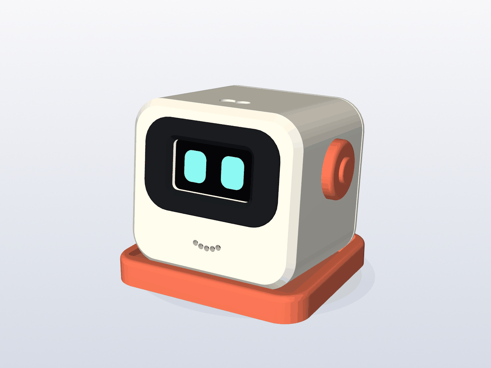 | 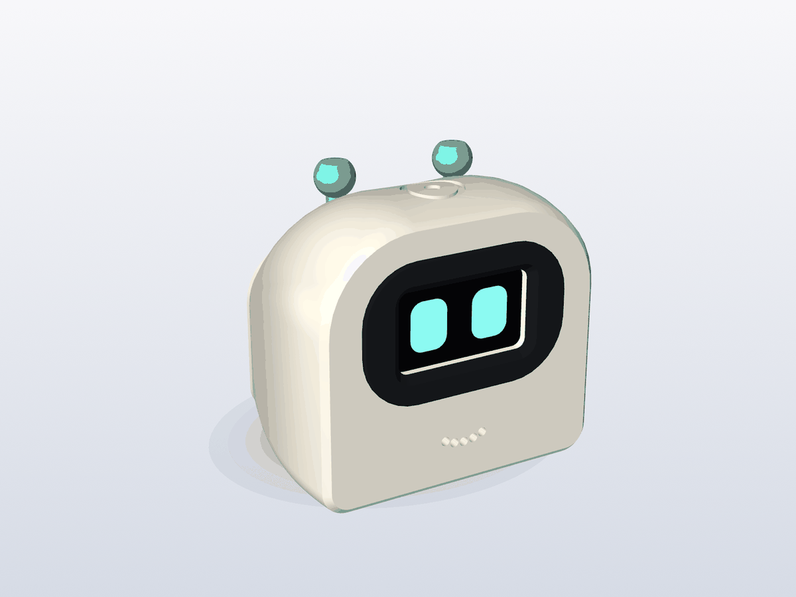 |
| Look | Rounded cube, black domino-mask visor, star touch spot, lightning bolts, red cape | Soft cube, coral ears, tilted dock | Helmet shape, mint antennas |
| Battery | **Yes** — bay for a 500 mAh LiPo + charger slot under the electronics deck | no (USB only) | no (USB only) |
| Back | CHARGE + CODE USB-C, power switch, back button in the cape's star | USB-C, vents | USB-C, vents |
| Size | 70 × 61 × 72 mm (with cape) | 79 × 59 × 62 mm | 70 × 59 × 68 mm |
| Plates | blue (or white) body + red cape + black mask | white + coral + black | white + mint + black |

All three share the same slide-out electronics tray, the OLED retainer and the self-centring visor idea. Open the ready `.3mf` plates in Bambu Studio and print. Print settings, parts, a quick fit check and step-by-step assembly: **[`5_Enclosures/README.md`](5_Enclosures/README.md)**.

## Quick start

### Get the project files

```bash
git clone https://github.com/sainikhil849/momo-esp32c3-desk-companion.git
cd momo-esp32c3-desk-companion
```

Choose the path that fits your goal:

- **Explore without hardware:** use the Wokwi simulator below; the firmware is prebuilt.
- **Build the robot:** follow the breadboard-first sequence in [`HARDWARE_GUIDE.md`](HARDWARE_GUIDE.md), then upload and connect the phone.
- **Change firmware or the app:** use the Arduino IDE settings below; regenerate the embedded app before compiling if you edit its HTML.

### A. Try it on your PC (Wokwi simulator in VS Code, ~5 minutes)

1. Install VS Code and the **Wokwi Simulator** extension (free licence).
2. *File → Open Folder* → `1_VSCode_Simulator/momo_wokwi` (open this folder itself; it contains `wokwi.toml`).
3. Click `diagram.json`, then **F1 → Wokwi: Start Simulator**.
4. **Blue button (T key)** = head touch, **red button (B key)** = back button, **knob** = battery, **slide switch** = charger cable. Click the MPU6050 and move *accelX* to tilt or shake.
5. While it runs, open **http://localhost:8180** on your PC — the Momo app. Press *Show a code on Momo*, type the 6 digits from the simulated screen, pair.

The firmware is prebuilt, nothing to compile. Details: [`HOW_TO_RUN.txt`](1_VSCode_Simulator/momo_wokwi/HOW_TO_RUN.txt). If Wi-Fi or the battery knob hangs on your setup, open `1_VSCode_Simulator/momo_wokwi_no_wifi` instead; this backup keeps the face, gestures, menus, games and local controls, but omits Wi-Fi and battery simulation.

### B. Put it on the robot (Arduino IDE)

1. Boards Manager: **esp32 by Espressif Systems** 3.1.1 or newer.
2. Library Manager: **Adafruit GFX Library**, **Adafruit SH110X**, **Adafruit BusIO**, **ArduinoJson** (v7), **ChronosESP32** (*Install all*).
3. Open `2_Robot_ArduinoIDE/momo/momo.ino` (keep the `.h` files next to it). Line 61 must read `#define WOKWI 0`.
4. Tools: Board **ESP32C3 Dev Module**, USB CDC On Boot **Enabled**, Partition Scheme **Huge APP (3MB No OTA/1MB SPIFFS)**, Flash Mode **DIO**.
5. Plug the cable into the **CODE** socket (the ESP32's own USB-C), upload, open the Serial Monitor at 115200.

### C. Connect your phone

- **Momo app (Wi-Fi):** on first start Momo shows a hotspot name and a random password. Join it, open http://192.168.4.1, pair with the code on Momo's screen, then *More → Wi-Fi* to put Momo on your home Wi-Fi. *Add to Home screen* gives you an app icon.
- **Chronos app (Bluetooth):** install *Chronos* from the Play Store, add a watch → **Momo**.

Full steps: [`HOW_TO_UPLOAD.txt`](2_Robot_ArduinoIDE/HOW_TO_UPLOAD.txt) and [`PHONE_SETUP.txt`](2_Robot_ArduinoIDE/PHONE_SETUP.txt).

### D. Recommended build and verification order

1. Run the simulator and try the touch/back gestures, games, battery controls and browser app.
2. Buy parts only after checking module pin labels and the battery dimensions. Follow [`HARDWARE_GUIDE.md`](HARDWARE_GUIDE.md) to wire and test on a breadboard; do not install an untested circuit in the enclosure.
3. Upload through the ESP32's **CODE** socket. Confirm the startup diagnostics report the screen, clock and motion sensor as found.
4. Test touch, button wake/sleep, buzzer, motion and clock before adding the battery circuit. Verify polarity and absence of shorts with a multimeter.
5. Test the battery/charger/power path on the bench and verify stable operation under Wi-Fi load before enclosing it. Use the charging-current and battery safety checks in the hardware guide.
6. Pair the Momo app and Chronos separately; verify local Wi-Fi pairing and Bluetooth behavior on the actual phone.
7. Fit the electronics into the selected body only after bench checks pass, then test CHARGE, CODE, switch, sleep and wake again with the enclosure assembled.

## How to talk to Momo

The head (touch) and the back button understand the same gestures.

| Gesture | On the face | In a menu | Elsewhere |
|---|---|---|---|
| **Tap** | Pet Momo | Next item | Next / play / done |
| **Hold 1 s, let go** | Open the menu | Choose | Choose / stop an alarm / snooze a reminder |
| **Double-tap** | — | **Back** one level | **Back** (close the screen, leave a game, cancel) |
| **Keep your hand on the head** (1.6 s+) | **Rub**: eyes close, purring, affection grows | — | — |
| **Hold the back button 3 s** | **Sleep** (screen off). Press it again to wake Momo | same | same |
| **Slide switch** | Fully off / on | | |
| Shake / tilt | Dizzy / music next-previous, tilt games | | |

Small hints on the screen ("Tap:> Hold:OK 2x:back", "Let go = menu · Keep = rub", "Keep holding: sleep" with a progress bar) teach the gestures as you use them.

## How it works

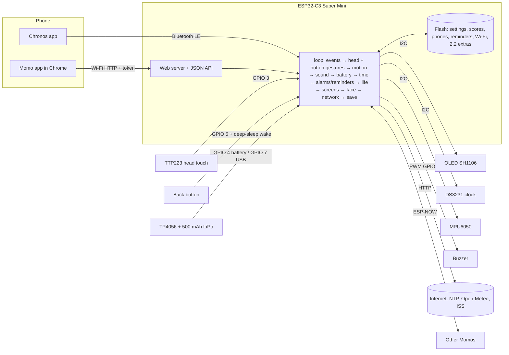

The firmware is a single cooperative `loop()` with no delays: every part does a little work and returns, so the face animates at 25 frames per second while sounds, alarms, Bluetooth and the web server all run.

**The gesture engine** reads the head and the button as two independent sources with the same rules: a press shorter than 0.8 s is a tap, a press that starts within 0.25 s of the last release is the second tap of a double-tap (= back), a press held 0.8 s is a hold, 1.6 s on the face is a rub (head), 3 s is sleep (button). On screens where double-tap means back, a single tap waits 0.25 s to be sure no second tap follows; in fast games taps act at once.

**Battery:** Momo reads the battery through a 100k/100k divider every second, smooths it, and turns the voltage into a percentage with a LiPo discharge table. The charger's USB 5 V, divided to 3 V, tells Momo it is plugged in. Sleep is the ESP32-C3's deep sleep with GPIO wake-up on the back button and a timer wake-up 20 s before the next alarm or reminder.

| File | What it contains |
|---|---|
| `momo.ino` | Settings you can change, pins, the shared state, the gesture engine (head + button), rub, personality, day rhythm, menus, alarms, reminders, music, phone events, setup and loop |
| `power.h` | **New:** battery reading and percentage, charger detection, low-battery warning, battery icon, sleep (deep sleep) with button and alarm wake-up |
| `hero.h` | **New:** the hero buddy (cape, mask), hero water and stretch animations, the hero start-up star |
| `store.h` | Settings, scores, paired phones, reminders and the 2.2 extras in flash + JSON for the app, backup and restore (every value range-checked) |
| `sound.h` | Buzzer driver, volume, 5 sound themes incl. hero, the 46 emotion sounds (+46 hero versions), alarm melodies, your own tune |
| `face.h` | The 46 expressions, smooth tweening, blinking, mini eyes, the hero mask |
| `schedule.h` | Time of day, quiet hours, night, play hours, which alarm/reminder is due |
| `games.h` | The 8 games and Pong |
| `screens.h` | Every screen: menu, clock, animated weather, music, alarm, water/stretch, reminders, charging, gesture hints, pairing, Wi-Fi |
| `net.h` | Wi-Fi, setup hotspot, pairing, the JSON API, internet time, weather with your refresh time and source, space station |
| `webapp.h` | The Momo app, gzipped into the firmware (43 KB → 13 KB) |

## Why these parts and tools — and why not the others

Every choice was made for one goal: **a small, cheap, reliable robot that a beginner can build and that keeps working without the internet.**

### Microcontroller: ESP32-C3 Super Mini

| Option | Why not (for Momo) |
|---|---|
| **ESP32-C3 Super Mini ✔** | Wi-Fi **and** Bluetooth LE 5 in one thumb-sized board, 400 KB RAM, 4 MB flash, USB-C, deep sleep with GPIO wake-up, about ₹240. |
| Seeed XIAO ESP32-C3 | Has a battery charger built in (nice!), but costs ₹649 (2.7×) and has fewer pins, and you would still add a divider to read the battery. The Super Mini + a ₹49 TP4056 board does the same for less and lets you choose the charge current. |
| Arduino Uno / Nano | No Wi-Fi or Bluetooth, 2 KB RAM. |
| ESP8266 | No Bluetooth, so no Chronos. |
| Classic ESP32 / ESP32-S3 | Bigger, more current; nothing in Momo needs the extra power. |
| Raspberry Pi Pico W / Pi Zero | Weaker Arduino Bluetooth support / a full Linux computer with slow boot and higher power. |

### Display: 1.3" SH1106 OLED (128×64)

| Option | Why not |
|---|---|
| **1.3" SH1106 OLED ✔** | Real black, so eyes glow; wide viewing angle; 2 wires shared with the other parts; low power — important on a battery. |
| 0.96" SSD1306 | Same technology, smaller face (supported with one setting). |
| Colour TFT | Backlight makes black grey, more pins and **much more power** (bad for battery life). |
| E-paper / LED matrix | Too slow to animate / too few pixels. |

### Touch: TTP223 — and why the head rub needs no extra sensor

| Option | Why not |
|---|---|
| **TTP223 ✔** | Senses a finger **through the plastic**, no holes, about ₹68. Tap, double-tap, hold and **rub** all come from timing on one pin. |
| Second touch sensor or a pressure sensor for the rub | More cost and wiring for something timing already tells us: a hand that *stays* on the head is a rub. |
| Capacitive "slider" pads (rub direction) | Needs a multi-channel touch chip; the ESP32-C3 has no touch pins. Maybe in a future version. |
| Push button on the head | Petting a button does not feel like petting. |

### Back button: a real button on the back

| Option | Why not |
|---|---|
| **7 mm panel push button ✔** | A different kind of sensor than the head (mechanical, not capacitive), so if one fails the other still works. Works with gloves, wet fingers, and in deep sleep it wakes Momo (a TTP223 needs power to sense). About ₹15, one hole in the back plate. |
| A second TTP223 on the back | Would fail the same way as the head (both capacitive) and cannot wake Momo from deep sleep while it is unpowered. |
| 6 × 6 mm tactile switch + printed cap | Works, but needs a small board or glue to hold it; the panel button screws in. |
| Using the ESP32's BOOT button | Hidden inside the body, and pressing it at power-on starts the bootloader. |

### Back as a gesture: double-tap

| Option | Why not |
|---|---|
| **Double-tap = back ✔** | Fast, works the same on every screen and on both inputs, and keeps tap (next) and hold (choose) as they were — nothing you learned in 2.1 changes. |
| A dedicated back button | The back button already is "the other input"; making it back-only would leave one gesture per input. |
| Long hold = back | Hold already means "choose" in menus. In Jump and Flappy, where taps are jumps, hold = back is used instead. |
| Triple tap | Too slow and too easy to miscount. |

### Power: TP4056 USB-C + 500 mAh LiPo + two diodes + slide switch

| Option | Why not |
|---|---|
| **TP4056 USB-C board with DW01 protection ✔** | ₹49, charges a single LiPo safely (CC/CV to 4.2 V), protects against over-charge, over-discharge and shorts, uses the same USB-C cable you already have. |
| TP4056 without protection (4 pads) | Nothing stops a short circuit or a deep discharge. |
| IP5306 / power-bank boards | Boost to 5 V and switch off automatically at low load — Momo's sleep current is low enough to make them cut power. Bigger, too. |
| AA / AAA cells | 3 × AA is big and heavy for this body; rechargeable NiMH sag to ~3.6 V. |
| 18650 cell | 3–6× the capacity, but 18 mm thick and 65 mm long — Momo would be twice the size. |
| Phone power bank | Works, but Momo is not cordless then. |
| **500 mAh LiPo ✔** | 5 mm thin, fits under the tray; 4–5 hours with Wi-Fi + Bluetooth is a design estimate, not a measured result. A 1000 mAh cell (6 × 34 × 50 mm) would need a deeper body. |
| **Two Schottky diodes (diode-OR) ✔** | While USB is in the CHARGE socket, Momo runs from USB and the battery only charges, so the charger sees a clean battery and stops properly when full (the board's own guide warns to disconnect the load while charging). They also stop the CODE socket's 5 V from ever pushing into the battery. |
| Load straight on OUT+ | Simple, but while charging the charger sees Momo's current and may never finish. |
| **Slide switch ✔** + soft sleep | The switch is a true off (zero draw except a 0.02 mA battery divider). Sleep keeps alarms working. Both, because each covers what the other cannot. |
| **Charge current 400 mA (R3 = 3 kΩ) ✔** | About 0.8 C for a 500 mAh cell, only if its datasheet permits that rate; verify the TP4056 board because clone resistor layouts vary. Charge time is an estimate. |

### Motion, clock, sound

| Choice | Why | Why not the others |
|---|---|---|
| **MPU6050** | Cheap, everywhere, I2C, read directly | ADXL345 fine too; tilt switches cannot tell left from right |
| **DS3231** | ±2 ppm, keeps time on a coin cell; alarms work without Wi-Fi | DS1307 drifts; NTP-only loses time after a power cut |
| **Passive buzzer + transistor** | Any frequency → melodies, 5 themes, 92 emotion sounds | Active buzzer: one beep; I2S speaker: more parts, more power |

### Hero theme: original, not a licensed character

| Option | Why |
|---|---|
| **Mini superhero Momo ✔** | Momo's own hero: a domino mask, a cape and a star — the general idea of a superhero that belongs to nobody — on Momo's own face, with original sounds. Free to build, share, post and even sell. |
| A famous comic or movie hero (suit, logo, mask, music) | Those characters, logos, costumes and theme tunes belong to their owners. Even in a hobby project they cannot be shared or posted freely, and a portfolio piece should be your own design. |

### Weather: refresh time and source

| Choice | Why |
|---|---|
| **Auto source ✔** | The phone's weather (Chronos) needs no Wi-Fi and no internet traffic from Momo; when it is old, Momo asks Open-Meteo itself. |
| **Phone / Internet only** | Phone: Momo without Wi-Fi. Internet: Momo without the Chronos app. |
| **10 min … 3 h, default 30 min ✔** | Weather rarely changes faster; 30 min keeps Wi-Fi traffic (and battery use) low. 10 min for rainy days, 3 h for the lowest power. |

### Software and tools

| Choice | Why | Why not the others |
|---|---|---|
| **Arduino-ESP32 core 3.x** | Current core, new LEDC API, Arduino IDE | ESP-IDF: harder for beginners; PlatformIO: one more tool |
| **Adafruit GFX + SH110X** | Simple drawing primitives for animated eyes | U8g2 also good |
| **ArduinoJson 7** | Safe parsing and escaping | `sprintf` JSON breaks on quotes |
| **Preferences (NVS)** | Wear-levelled, survives power cuts and updates; 2.2 settings live in their own key, so 2.1 data is untouched | EEPROM emulation, LittleFS |
| **Deep sleep with GPIO wake** | Microamps for the chip, wake on the back button or a timer | Light sleep keeps more on; "screen off but running" drains the battery in hours |
| **Open-Meteo** | Free, no API key | Keyed APIs put a secret in every firmware copy |
| **ESP-NOW for hugs** | No router or server | MQTT needs a broker |
| **Wokwi in VS Code** | Simulates the ESP32-C3, OLED, RTC, MPU6050, buttons, a knob, a switch, a buzzer and Wi-Fi | Tinkercad: no ESP32 |
| **Huge APP partition, Flash Mode DIO** | 1.7 MB firmware; DIO matches the board and the simulator | — |

### Body: 3D-printed PLA, designed for the Bambu Lab A1 mini

| Choice | Why | Why not the others |
|---|---|---|
| **PLA** | Accurate, crisp details, many colours | PETG strings; ABS warps on an open printer |
| **No supports** | Clean surfaces, nothing to pick out of a closed shell | Supports scar the face and the battery bay |
| **Separate black mask + red cape** | Real colours on any A1 mini, with or without the AMS lite | Painting is messy; AMS purges waste filament |
| **Battery bay under a deck** | The battery and charger stay put, the tray slides in above them as before | Battery on the tray would make it heavy and stress the wires |
| **Cape on two pegs** | Comes off in a second to open the back | Glued capes break when you open Momo |
| **Hook + 2 screws underneath** | Opens many times, nothing visible | PLA snap-fits crack |
| **CadQuery (Python)** | The design is text with named sizes; STEP files for any CAD program | Fusion 360: cloud account; OpenSCAD: no STEP |

## Security and privacy

- **Pairing needs physical presence:** a 6-digit code shown on Momo's screen (2 minutes). 5 wrong codes lock pairing for 5 minutes.
- **Secret token per phone:** a random 256-bit token stored only in that browser; Momo keeps just its SHA-256 fingerprint. Up to 3 phones.
- **The Wi-Fi password never leaves Momo** — not in the app, not in backups, not on the Serial Monitor.
- **Local only:** reachable on your own Wi-Fi, never from the internet. Weather requests carry only your city's coordinates.
- **Honest limitation:** plain HTTP on your home network (WPA2 protects the air; the token protects every change).

## The Momo app and its API

The app is one HTML file (`3_Phone_App/index.html`) packed into the firmware by `make_webapp.py`. Every call except `/api/info` and pairing needs the header `X-Momo-Token`.

| Method | Path | What it does |
|---|---|---|
| GET | `/` | The app (gzipped) |
| GET | `/api/info` | Name, version, faces, games, whether this phone is paired |
| POST | `/api/pair/start`, `/api/pair` | Pairing with the code on the screen |
| GET | `/api/state` | Time, face, affection, water/stretch, next alarm/reminder, weather (+ `ageMin`), **battery** (`present`, `percent`, `mv`, `charging`, `full`), music, Wi-Fi, scores |
| GET / POST | `/api/settings` | All settings, incl. 2.2: `look` (0 classic, 1 hero), `sound.theme` (0–4, 4 = hero), `rub`, `lowBattAlert`, `weather.every` (10–180 min), `weather.source` (0 auto, 1 phone, 2 internet) |
| POST | `/api/action` | `face`, `sound`, `tune`, `pet`, `water`, `remindWater`, `stretch`, `alarm`, `note`, `weather`, **`weatherNow`**, **`back`**, `find`, `game`, `music`, `scoresReset`, `wifiSetup` |
| GET / POST | `/api/backup`, `/api/restore` | Settings, alarms, reminders and scores (no Wi-Fi password, no tokens) |
| POST / GET | `/api/wifi`, `/api/wifi/scan` | Join a network / list networks |
| GET / POST | `/api/devices`, `/api/unpair` | Paired phones |

## How it was tested

Momo was tested without real hardware, in four independent ways (details: `TEST_REPORT.txt`):

1. **Real compiler** — Arduino-ESP32 3.3.12 and 3.1.1, robot and simulator builds, **0 warnings** from Momo's code.
2. **Espressif's ESP32-C3 emulator (QEMU)** — the real compiled firmware with scripted touches *and* back-button presses ran through every menu, game, reminder and alarm, a head rub, the charger being plugged in and out, a low battery, sleep and wake-up. Free memory flat at ~280 KB, no crash.
3. **Desktop test rig** — Momo's own code compiled on a PC with simulated screen, clock, motion sensor, touch, **back button, battery and charger, deep sleep**, buzzer, Wi-Fi, internet, Chronos and ESP-NOW: **370 checks** (98 of them new for 2.2: every gesture on both inputs, a button held down at start, rub, back on every screen, charging/full/unplug/low/empty, sleep with button and alarm wake-up, all 46 hero sounds unique, hero animations, all 8 weather scenes, refresh time and source, upgrade from 2.1 keeping everything).
4. **The app in a real browser** — headless Chrome at phone size against Momo's real web-server code: **143 checks** (pairing, faces, games, alarms, reminders, sounds, battery on Home, Back, Momo's look, weather refresh/source/Update now, Wi-Fi, backup, restore, unpairing).

Not tested here: real Bluetooth with the Chronos app, a real router, the real buzzer, screen, battery and charger. The report describes 513 checks, but this project bundle does not include the test harness used to run them; treat the report as evidence supplied with the project, not as a locally repeatable test command. Bench-test the physical power and charging circuit before relying on battery-life estimates.

## Project structure

```
Momo2_Project/
├── README.md                     ← this file
├── HARDWARE_GUIDE.md             ← shopping list with Hyderabad prices, wiring, soldering, battery safety
├── README_FIRST.txt              ← short start guide
├── TEST_REPORT.txt               ← all checks
├── 1_VSCode_Simulator/
│   ├── momo_wokwi/               ← open this folder in VS Code (prebuilt firmware in build/)
│   └── momo_wokwi_no_wifi/       ← backup simulator without Wi-Fi
├── 2_Robot_ArduinoIDE/
│   ├── momo/                     ← momo.ino + 10 .h files (upload this)
│   ├── HOW_TO_UPLOAD.txt
│   └── PHONE_SETUP.txt
├── 3_Phone_App/                  ← the Momo app source + make_webapp.py
├── 4_Pictures/                   ← hero screens, weather, faces, app, bodies, wiring
└── 5_Enclosures/
    ├── README.md                 ← print settings, parts, assembly, why/why not
    ├── C_Hero_Momo/              ← 3 ready plates (.3mf) + STL + STEP   (new)
    ├── A_Momo_Cube/
    ├── B_Momo_Pod/
    ├── pictures/
    └── source/                   ← parametric CadQuery design, checks, plates, renders
```

## Customising

- **Top of `momo.ino`:** `WOKWI`, `SCREEN_IS_SSD1306`, `OLED_ADDR`, `FLIP_SCREEN`, pins, and the gesture timing: `LONG_PRESS` (800 ms), `DOUBLE_TAP_MS` (250 ms), `RUB_MS` (1600 ms), `SLEEP_HOLD_MS` (3000 ms).
- **`power.h`:** battery and USB pins, the LiPo percentage table, the low (15 %) and empty (3.35 V) levels.
- **From the app:** look and sound theme, head rub, low-battery warning, weather refresh and source, wake/sleep times, quiet hours, play hours, alarms, reminders, your own tune, city and time zone.
- **Change the app:** edit `3_Phone_App/index.html`, then from the project root run `python 3_Phone_App/make_webapp.py`. The script regenerates `webapp.h` for the robot and both simulator variants; rebuild/re-upload the firmware you want to use. The supplied simulator binaries are prebuilt and are not changed by editing the source.

## Troubleshooting

| Problem | Fix |
|---|---|
| Restarts again and again after upload | Flash Mode **DIO** |
| "Sketch too big" | Partition Scheme **Huge APP** |
| Picture shifted, noisy column | SSD1306 screen: `#define SCREEN_IS_SSD1306 1` |
| Clock / motion sensor NOT FOUND | SDA (8), SCL (9), 3.3 V; MPU6050 AD0 to 3.3 V |
| A double-tap opens the item instead of going back | Tap a little faster (second tap within 0.25 s), or raise `DOUBLE_TAP_MS` |
| Rub opens the menu | Keep the hand on the head a bit longer than 1.6 s |
| Back button does nothing / Momo will not wake | Button between GPIO 5 and G, 10 kΩ pull-up to 3.3 V |
| No battery icon | Battery divider on GPIO 4 missing, or no battery (then Momo hides the icon on purpose) |
| Never shows "Charging" | Cable in the CODE socket (that one does not charge), or the GPIO 7 divider is missing |
| Board gets hot while charging | R3 still 1.2 kΩ — change to 3 kΩ |
| The app cannot reach Momo | Same Wi-Fi; Menu → Phone & Wi-Fi → App address |
| Wokwi: "wokwi.toml not found" | Open the `momo_wokwi` folder itself |
| Wokwi: always "Charging" / black screen | Slide switch to the left / Momo is asleep — press the red button |

## Roadmap

- A fuel-gauge chip (MAX17048) for an exact battery percentage
- I2S speaker for a real voice
- OTA (over-the-air) updates from the app
- Rub direction with a touch slider; more hero costumes (helmets, capes) as swappable prints

## Credits and licences

| Library / tool | Author | Licence |
|---|---|---|
| Adafruit GFX Library, SH110X / SSD1306 | Adafruit Industries | BSD |
| Adafruit BusIO | Adafruit Industries | MIT |
| ArduinoJson | Benoît Blanchon | MIT |
| ChronosESP32, ESP32Time | Felix Biego (fbiego) | MIT |
| NimBLE-Arduino | h2zero | Apache-2.0 |
| Arduino-ESP32 core | Espressif Systems | LGPL-2.1 |
| Open-Meteo weather API | Open-Meteo.com | Free for non-commercial use (CC BY 4.0 data) |
| Wokwi simulator | Wokwi | Free licence for VS Code |
| CadQuery, trimesh, manifold3d, VTK | their contributors / Kitware | Apache-2.0 / MIT / BSD |

Momo's own code, sounds, the hero theme and the 3D designs are original. Choose a licence for your repository (MIT is common for hobby hardware) and add it as `LICENSE`.

---

*Built and tested with care. If you build a Momo, share a picture!*
